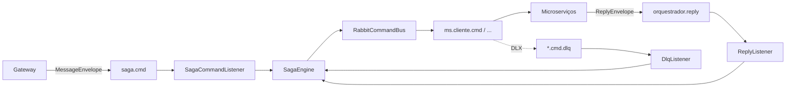

# 5. Pastas do `ms-saga` — propósito e fluxos

[← Voltar ao índice](./README.md) · [Gateway](./06-pastas-gateway.md) · [Formatos de dados](./07-fluxos-e-formatos.md)

Este documento descreve **cada pasta** em  
`backend/services/saga/src/main/kotlin/br/ufpr/dac/bantads/saga/`: o que ela faz, **quem entrega** informação, **quem recebe**, **por quê**, e **quais funções** participam.

## 5.0 Mapa mental da árvore

```
saga/
├── SagaApplication.kt     → bootstrap Spring (sem JDBC)
├── amqp/                  → bordas RabbitMQ (entrada/saída AMQP)
├── config/                → propriedades e relógio
├── engine/                → orquestração (cérebro da saga)
├── health/                → HTTP /health
├── job/                   → modelo JobRecord (espelho do job no Redis)
└── store/                 → persistência Redis (estado, jobs, locks, cache)
```

O ms-saga **não** expõe API de negócio para o frontend. Ele **consome** filas, **publica** comandos nos microserviços e **atualiza** jobs no Redis. O Gateway é o único ponto HTTP que o cliente usa para disparar saga e consultar job.

---

## 5.1 Raiz: `SagaApplication.kt`

| O quê | Por quê |
|-------|---------|
| `@SpringBootApplication` com exclusão de JPA/Flyway/DataSource | Este serviço **não** tem banco relacional próprio; estado fica no **Redis** |
| `@EnableScheduling` | Liga o `TimeoutScanner` (varre sagas com etapa transactional expirada) |
| `@EnableConfigurationProperties(SagaProperties::class)` | Injeta timeouts e TTLs de [`config/SagaProperties.kt`](../backend/services/saga/src/main/kotlin/br/ufpr/dac/bantads/saga/config/SagaProperties.kt) |

**Fluxo:** nenhum dado passa por aqui em runtime; só sobe o contexto Spring que registra listeners, engine e stores.

---

## 5.2 Pasta `amqp/` — portas do barramento

Responsabilidade: **traduzir bytes JSON das filas** em chamadas ao `SagaEngine` e **publicar** `MessageEnvelope` nas filas dos participantes.

| Arquivo | Recebe de | Entrega para | Função principal | Formato |
|---------|-----------|--------------|------------------|---------|
| [`SagaCommandListener.kt`](../backend/services/saga/src/main/kotlin/br/ufpr/dac/bantads/saga/amqp/SagaCommandListener.kt) | Fila `saga.cmd` (Gateway) | `SagaEngine.start` | `onCommand(body: String)` | `String` JSON → `MessageEnvelope` |
| [`ReplyListener.kt`](../backend/services/saga/src/main/kotlin/br/ufpr/dac/bantads/saga/amqp/ReplyListener.kt) | Fila `orquestrador.reply` (MSs) | `SagaEngine.onReply` | `onReply(body: String)` | `String` JSON → `ReplyEnvelope` |
| [`DlqListener.kt`](../backend/services/saga/src/main/kotlin/br/ufpr/dac/bantads/saga/amqp/DlqListener.kt) | `*.cmd.dlq` | `SagaEngine.onDlq` | `onDlq(body: String)` | `MessageEnvelope` (comando que falhou após retries) |
| [`RabbitCommandBus.kt`](../backend/services/saga/src/main/kotlin/br/ufpr/dac/bantads/saga/amqp/RabbitCommandBus.kt) | `SagaEngine` (via `CommandBus`) | Filas `ms.*.cmd` | `publish(queue, envelope)` | `MessageEnvelope` → `String` JSON |

### Por que existe a interface `CommandBus`?

[`CommandBus.kt`](../backend/services/saga/src/main/kotlin/br/ufpr/dac/bantads/saga/engine/CommandBus.kt) separa o **motor** da **implementação Rabbit**. Nos testes unitários do engine injeta-se um bus em memória; em produção usa-se `RabbitCommandBus`.

### Diagrama de bordas AMQP



---

## 5.3 Pasta `engine/` — orquestração e regras de negócio distribuído

É o **núcleo**: define receitas, avança etapas, mescla payload, compensa, conclui job.

| Arquivo | Papel | Principais funções / tipos |
|---------|-------|---------------------------|
| [`SagaRegistry.kt`](../backend/services/saga/src/main/kotlin/br/ufpr/dac/bantads/saga/engine/SagaRegistry.kt) | **Receitas** (lista ordenada de `SagaStep` por tipo de saga) | `aprovarCliente()`, `inserirGerente()`, … |
| [`SagaDefinition.kt`](../backend/services/saga/src/main/kotlin/br/ufpr/dac/bantads/saga/engine/SagaDefinition.kt) | Agrupa nome + passos | DTO da receita |
| [`SagaStep.kt`](../backend/services/saga/src/main/kotlin/br/ufpr/dac/bantads/saga/engine/SagaStep.kt) | Uma etapa: `tipo`, fila, `StepKind`, compensação opcional | Configuração estática |
| [`StepKind.kt`](../backend/services/saga/src/main/kotlin/br/ufpr/dac/bantads/saga/engine/StepKind.kt) | `TRANSACTIONAL`, `FIRE_AND_FORGET`, `LOCAL` | Define se espera reply |
| [`SagaEngine.kt`](../backend/services/saga/src/main/kotlin/br/ufpr/dac/bantads/saga/engine/SagaEngine.kt) | **Máquina de estados** | `start`, `advance`, `onReply`, `onDlq`, `compensate`, `complete`, `failJob` |
| [`SagaState.kt`](../backend/services/saga/src/main/kotlin/br/ufpr/dac/bantads/saga/engine/SagaState.kt) | Instância em execução | `sagaId`, `etapaAtual`, `payload`, `waitingTipo`, `succeededTipos`, … |
| [`SagaStatuses.kt`](../backend/services/saga/src/main/kotlin/br/ufpr/dac/bantads/saga/engine/SagaStatuses.kt) | `EM_ANDAMENTO`, `COMPENSANDO`, `CONCLUIDO`, `FALHA` | Status interno da saga |
| [`TimeoutScanner.kt`](../backend/services/saga/src/main/kotlin/br/ufpr/dac/bantads/saga/engine/TimeoutScanner.kt) | Job agendado | `failTimedOutSteps()` → `engine.failTimedOutSteps()` |
| [`SagaSecrets.kt`](../backend/services/saga/src/main/kotlin/br/ufpr/dac/bantads/saga/engine/SagaSecrets.kt) | Senhas geradas (auth) **fora** do payload persistido | `put` / `get` por `sagaId` (Redis) |
| [`PayloadSanitize.kt`](../backend/services/saga/src/main/kotlin/br/ufpr/dac/bantads/saga/engine/PayloadSanitize.kt) | Remove `senha`/`password` antes de salvar estado | `withoutPassword()` |
| [`CacheInvalidator.kt`](../backend/services/saga/src/main/kotlin/br/ufpr/dac/bantads/saga/engine/CacheInvalidator.kt) | Contrato para invalidar cache do Gateway | Implementado em `store/` |
| [`CompensationGuard.kt`](../backend/services/saga/src/main/kotlin/br/ufpr/dac/bantads/saga/engine/CompensationGuard.kt) | Contrato de lock (evitar compensação duplicada) | Implementado em `store/` |

### Quem entrega o quê para o engine?

| Origem | Evento | Método no engine | Por quê |
|--------|--------|------------------|---------|
| `SagaCommandListener` | Nova saga (`tipo` de alto nível, ex. `aprovar-cliente`) | `start(envelope)` | Criar `SagaState` e disparar 1ª etapa |
| `ReplyListener` | MS terminou um comando transactional | `onReply(reply)` | Mesclar payload ou compensar |
| `DlqListener` | Mensagem foi para DLQ após falhas de infra | `onDlq(envelope)` | Tratar como falha irrecuperável da etapa |
| `TimeoutScanner` | Prazo da etapa transactional estourou | `failTimedOutSteps()` | Compensar como se o MS não tivesse respondido |

### Remodelagem do payload (dentro do engine)

1. **Entrada (`start`):** payload do Gateway (JSON map) → cópia sem senha → `SagaState.payload`.
2. **Cada `onReply` sucesso:** `merged = state.payload + reply.payload.withoutPassword()` — acumulativo.
3. **Publicação para MS (`advance`):** novo `MessageEnvelope` com **mesmo** `sagaId`, `tipo` da etapa atual, `payload` enriquecido (`extrasFor` no engine injeta campos que a receita exige, ex. listas ou senha só na memória).

Detalhe passo a passo no fluxo R9: [02-fluxo-aprovar-cliente.md](./02-fluxo-aprovar-cliente.md).

---

## 5.4 Pasta `store/` — Redis (estado durável da saga)

Implementações concretas das interfaces usadas pelo engine.

| Arquivo | Interface | Chave / dado | Quem escreve | Quem lê |
|---------|-----------|--------------|--------------|---------|
| [`SagaStateStore.kt`](../backend/services/saga/src/main/kotlin/br/ufpr/dac/bantads/saga/store/SagaStateStore.kt) | Contrato | — | — | — |
| [`RedisSagaStateStore.kt`](../backend/services/saga/src/main/kotlin/br/ufpr/dac/bantads/saga/store/RedisSagaStateStore.kt) | Estado da saga | `saga:{sagaId}` JSON | `SagaEngine` a cada transição | Listeners + scanner |
| [`JobStore.kt`](../backend/services/saga/src/main/kotlin/br/ufpr/dac/bantads/saga/store/JobStore.kt) | Contrato job | — | — | — |
| [`RedisJobStore.kt`](../backend/services/saga/src/main/kotlin/br/ufpr/dac/bantads/saga/store/RedisJobStore.kt) | Job assíncrono | `job:{jobId}` (compatível com Gateway) | Gateway (inicial) + `SagaEngine` (fim) | Gateway `jobs.ts` |
| [`RedisCompensationGuard.kt`](../backend/services/saga/src/main/kotlin/br/ufpr/dac/bantads/saga/store/RedisCompensationGuard.kt) | Lock compensação | Redis set/lock | `SagaEngine.compensate` | Mesmo |
| [`RedisCacheInvalidator.kt`](../backend/services/saga/src/main/kotlin/br/ufpr/dac/bantads/saga/store/RedisCacheInvalidator.kt) | Invalida cache HTTP | chaves de cache do GW | `SagaEngine.complete` | — |

**Por quê Redis e não banco no saga?** Latência baixa, TTL automático, mesmo repositório que o Gateway usa para **jobs** — o cliente faz polling em uma única chave.

**Formato:** `SagaState` e `JobRecord` serializados com `BantadsJson` (Jackson Kotlin), espelhando tipos do módulo `shared`.

---

## 5.5 Pasta `job/` — modelo do job

| Arquivo | Conteúdo |
|---------|----------|
| [`JobRecord.kt`](../backend/services/saga/src/main/kotlin/br/ufpr/dac/bantads/saga/job/JobRecord.kt) | `jobId`, `status`, `resultType`, `dominio`, `resourceId`, `resultado`, `erro` |

**Fluxo:** ao concluir, o engine grava status `CONCLUIDO` ou `FALHA` e, quando aplicável, `resultado` para `GET /jobs/:id/result` no Gateway. O campo `cpf` do job (quem iniciou) é definido no Gateway na criação; o saga **não** remove isso ao atualizar.

---

## 5.6 Pasta `config/`

| Arquivo | Função |
|---------|--------|
| [`SagaProperties.kt`](../backend/services/saga/src/main/kotlin/br/ufpr/dac/bantads/saga/config/SagaProperties.kt) | `step-timeout`, `timeout-scan-ms`, TTL saga/job no Redis |
| [`ClockConfig.kt`](../backend/services/saga/src/main/kotlin/br/ufpr/dac/bantads/saga/config/ClockConfig.kt) | `Clock` injetável (testes de timeout) |

**Por quê:** centralizar limites operacionais sem espalhar números mágicos no `SagaEngine`.

---

## 5.7 Pasta `health/`

| Arquivo | Função |
|---------|--------|
| [`HealthController.kt`](../backend/services/saga/src/main/kotlin/br/ufpr/dac/bantads/saga/health/HealthController.kt) | Endpoint Spring Actuator / health para orquestração Docker |

Não participa do fluxo de mensagens; só sinal de vida.

---

## 5.8 Tabela resumo: função → pasta

| Pergunta | Pasta / arquivo |
|----------|-----------------|
| Quem **começa** a saga após o Gateway? | `amqp/SagaCommandListener` → `engine/SagaEngine.start` |
| Quem **decide** a ordem dos MSs? | `engine/SagaRegistry` + `SagaEngine.advance` |
| Quem **envia** comando para cliente/conta/…? | `amqp/RabbitCommandBus` |
| Quem **junta** dados entre etapas? | `engine/SagaEngine.onReply` |
| Onde **não** fica a senha em claro? | `PayloadSanitize` + `SagaSecrets` |
| Quem **atualiza** o job que o usuário consulta? | `engine` + `store/RedisJobStore` |
| Quem trata **falha** de infra? | `amqp/DlqListener`, `engine/TimeoutScanner` |

---

## 5.9 Próximos passos de leitura

- Contratos AMQP compartilhados: módulo [`backend/services/shared/.../amqp`](../backend/services/shared/src/main/kotlin/br/ufpr/dac/bantads/shared/amqp/)
- Lado HTTP que dispara sagas: [06-pastas-gateway.md](./06-pastas-gateway.md)
- Tabela de transformações HTTP → AMQP → Redis: [07-fluxos-e-formatos.md](./07-fluxos-e-formatos.md)