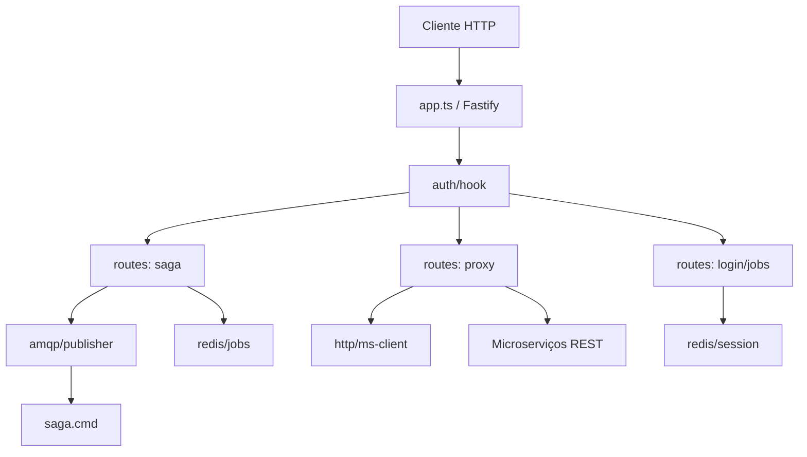

# 6. Pastas do Gateway — propósito e fluxos

[← Voltar ao índice](./README.md) · [ms-saga](./05-pastas-ms-saga.md) · [Formatos de dados](./07-fluxos-e-formatos.md)

**Tutoriais transversais (fluxos, auth, Redis, catálogo):** [08](./08-gateway-tipos-de-fluxo.md) · [09](./09-gateway-autenticacao-acl.md) · [10](./10-gateway-redis-completo.md) · [11](./11-gateway-catalogo-funcionalidades.md)

O Gateway (`backend/gateway/src/`) é a **API HTTP pública** do backend: autenticação, proxy síncrono para microserviços, disparo de **sagas assíncronas** e consulta de **jobs**. Cada pasta agrupa uma responsabilidade na fronteira entre o cliente (browser/app) e o restante do sistema.

## 6.0 Árvore de pastas e arquivos de entrada

```
gateway/src/
├── index.ts          → sobe servidor: Redis, Rabbit publisher, listen
├── app.ts            → monta Fastify, CORS, hook de auth, registra rotas
├── config.ts         → variáveis de ambiente (portas, URLs, JWT, TTL job)
├── amqp/             → publicação em saga.cmd (só sagas)
├── auth/             → JWT + ACL + hook global
├── http/             → cliente HTTP para MSs, erros, HATEOAS, datas
├── redis/            → abstração KV, jobs, sessão, cache
├── routes/           → rotas HTTP (uma função register* por arquivo)
└── types/            → envelopes AMQP, enums, schemas Zod, filas
```

---

## 6.1 Raiz: `index.ts` e `app.ts`

### `index.ts`

| Passo | Função | Entrega / recebe |
|-------|--------|------------------|
| 1 | `loadConfig()` | Lê env → `AppConfig` |
| 2 | `connectRabbitPublisher(rabbitUrl)` | Abre AMQP; retorna `SagaPublisher.publish` |
| 3 | `buildApp({ config, publisher })` | Instância Fastify pronta |
| 4 | `app.listen` | Aceita HTTP |

**Por quê Rabbit só aqui?** Rotas de saga precisam do publisher real; testes injetam `noopSagaPublisher` via `BuildAppOptions`.

### `app.ts` — composição

| Registro | Arquivo | Tipo de fluxo |
|----------|---------|---------------|
| `registerAuthHook` | `auth/hook.ts` | Todas as rotas (exceto públicas) |
| `registerLogin` / `registerLogout` | `routes/login.ts`, `logout.ts` | Auth + Redis sessão |
| `registerAprovacao`, `inserir-gerente`, `remover-gerente` | `routes/*.ts` | **Saga** → `amqp/publisher` |
| `registerJobs` | `routes/jobs.ts` | Leitura Redis job |
| `registerProxy` | `routes/proxy.ts` | **HTTP direto** aos MSs |
| `registerRelatorio`, `registerReboot` | rotas auxiliares | HTTP composto / admin |



---

## 6.2 Pasta `amqp/` — única saída assíncrona do Gateway

| Arquivo | Função | Formato |
|---------|--------|---------|
| [`publisher.ts`](../backend/gateway/src/amqp/publisher.ts) | `connectRabbitPublisher`, `publish(envelope)` | `MessageEnvelope` → JSON → fila `saga.cmd` |

**Quem chama `publish`?** Apenas rotas de saga:

- [`aprovacao.ts`](../backend/gateway/src/routes/aprovacao.ts) — `tipo: aprovar-cliente`
- [`inserir-gerente.ts`](../backend/gateway/src/routes/inserir-gerente.ts) — `inserir-gerente`
- [`remover-gerente.ts`](../backend/gateway/src/routes/remover-gerente.ts) — `remover-gerente`

**Por quê o Gateway não publica em `ms.cliente.cmd`?** Separação de papéis: o Gateway só **pede** uma saga de alto nível; o **ms-saga** decompõe em comandos atômicos.

**Transformação na saída:**

1. Corpo HTTP (path params + JSON body) → `payload` do envelope.
2. `jobId = randomUUID()` → `sagaId` no envelope (correlação com Redis e todos os MSs).
3. `timestamp` ISO via [`http/dates.ts`](../backend/gateway/src/http/dates.ts).

---

## 6.3 Pasta `auth/` — identidade antes de qualquer rota

| Arquivo | Responsabilidade |
|---------|------------------|
| [`jwt.ts`](../backend/gateway/src/auth/jwt.ts) | Assinar e validar JWT (`x-access-token`) |
| [`acl.ts`](../backend/gateway/src/auth/acl.ts) | Mapa rota → perfil; rotas públicas |
| [`hook.ts`](../backend/gateway/src/auth/hook.ts) | Hook `onRequest`: token, sessão Redis, `request.user`, 401/403/404 |

**Fluxo de dados:**

1. **Entrada:** header `x-access-token` (string).
2. **Validação:** JWT + `jti` não revogado + sessão em [`redis/session.ts`](../backend/gateway/src/redis/session.ts).
3. **Saída:** `request.user` `{ cpf, tipo, jti, ... }` usado em rotas (ex.: `solicitadoPorCpf`, headers `X-User-CPF` no proxy).

**Por quê sessão no Redis além do JWT?** Logout e invalidação centralizada (`isRevoked`).

---

## 6.4 Pasta `redis/` — estado efêmero compartilhado com o saga

| Arquivo | Dado | Quem escreve | Quem lê |
|---------|------|--------------|---------|
| [`store.ts`](../backend/gateway/src/redis/store.ts) | Interface `KeyValueStore` | — | Testes mock |
| [`redis-store.ts`](../backend/gateway/src/redis/redis-store.ts) | Cliente ioredis | — | App |
| [`jobs.ts`](../backend/gateway/src/redis/jobs.ts) | `job:{id}` JSON | Rotas saga (`saveJob`), saga engine (atualização) | `routes/jobs.ts` |
| [`session.ts`](../backend/gateway/src/redis/session.ts) | Sessões / revogação | `login`, `logout` | `auth/hook` |
| [`cache.ts`](../backend/gateway/src/redis/cache.ts) | Cache de listagens cliente/gerente | `proxy` após GET | `proxy` antes de forward |

**Formato do job (Gateway cria):**

```json
{
  "jobId": "<uuid>",
  "status": "PENDENTE",
  "cpf": "<cpf do usuário autenticado>"
}
```

O ms-saga **adiciona** `resultType`, `resultado`, `erro`, etc. ao finalizar — mesma chave `job:{jobId}`.

**Por quê TTL?** [`config.ts`](../backend/gateway/src/config.ts) define `JOB_TTL_SECONDS`; jobs antigos somem do polling.

---

## 6.5 Pasta `http/` — falar REST com os microserviços

| Arquivo | Função |
|---------|--------|
| [`ms-client.ts`](../backend/gateway/src/http/ms-client.ts) | `msRequest`: fetch com base URL do MS |
| [`errors.ts`](../backend/gateway/src/http/errors.ts) | Corpos de erro padronizados (`Erros`, `authError`) |
| [`hateoas.ts`](../backend/gateway/src/http/hateoas.ts) | Links `_links` em respostas 2xx do proxy |
| [`pt-br.ts`](../backend/gateway/src/http/pt-br.ts) | Mensagens em português |
| [`dates.ts`](../backend/gateway/src/http/dates.ts) | `nowTimestamp()` para envelopes |

**Fluxo proxy (síncrono):**

1. Request HTTP do cliente → `identityHeaders` (CPF/tipo do usuário).
2. `msRequest` → resposta JSON do MS (inalterada em erro).
3. Sucesso: opcional `applyHateoas`, `rewriteLocation` para URL pública do Gateway.

**Diferença saga vs proxy:** proxy não usa `MessageEnvelope`; corpo é JSON de domínio (conta, cliente, etc.) direto no MS.

---

## 6.6 Pasta `routes/` — mapa de endpoints

Cada arquivo exporta `register*(app, deps)` e **não** mistura responsabilidades.

| Arquivo | Método / caminho | Entrega | Recebe resposta |
|---------|------------------|---------|-----------------|
| [`login.ts`](../backend/gateway/src/routes/login.ts) | `POST /login` | Credenciais → ms-auth | JWT + sessão Redis |
| [`logout.ts`](../backend/gateway/src/routes/logout.ts) | `POST /logout` | Revoga `jti` | 204 |
| [`aprovacao.ts`](../backend/gateway/src/routes/aprovacao.ts) | `POST /solicitacoes/:cpf/aprovacao` | `saga.cmd` + job | 202 + `Location` job |
| [`inserir-gerente.ts`](../backend/gateway/src/routes/inserir-gerente.ts) | `POST /gerentes` | body validado Zod → saga | 202 |
| [`remover-gerente.ts`](../backend/gateway/src/routes/remover-gerente.ts) | `DELETE /gerentes/:cpf` | saga | 202 |
| [`jobs.ts`](../backend/gateway/src/routes/jobs.ts) | `GET /jobs/:id/status`, `.../result` | — | JSON do Redis |
| [`proxy.ts`](../backend/gateway/src/routes/proxy.ts) | Vários prefixos (`/contas`, `/clientes`, …) | HTTP ao MS | JSON síncrono |
| [`composition.ts`](../backend/gateway/src/routes/composition.ts) | Helpers | Agrega chamadas MS | Usado por proxy/relatório |
| [`relatorio.ts`](../backend/gateway/src/routes/relatorio.ts) | Relatórios | Vários MSs | JSON agregado |
| [`reboot.ts`](../backend/gateway/src/routes/reboot.ts) | Admin / testes | Pode disparar echo saga | — |

### Padrão comum das rotas de saga

1. Validar entrada (path/body).
2. `jobId = randomUUID()`.
3. `saveJob` com `PENDENTE` e `cpf` do usuário (controle de ownership em `jobs.ts`).
4. `publisher.publish({ sagaId: jobId, tipo, timestamp, payload })`.
5. Em falha de publish → job `FALHA`.
6. `202 Accepted` + header `Location: /jobs/{jobId}/status`.

**Por quê 202 e não 200?** A operação de negócio ainda não terminou; o cliente deve **poll** o job.

---

## 6.7 Pasta `types/` — contratos e validação

| Arquivo | Conteúdo |
|---------|----------|
| [`envelopes.ts`](../backend/gateway/src/types/envelopes.ts) | `MessageEnvelope`, `ReplyEnvelope` (espelho do shared Kotlin) |
| [`command-types.ts`](../backend/gateway/src/types/command-types.ts) | Constantes `aprovar-cliente`, … |
| [`queues.ts`](../backend/gateway/src/types/queues.ts) | `SAGA_CMD` (única fila que o GW publica) |
| [`enums.ts`](../backend/gateway/src/types/enums.ts) | `JobStatus`, `ResultType`, perfis, … |
| [`schemas.ts`](../backend/gateway/src/types/schemas.ts) | Zod: login, gerente, transferência, envelopes |
| [`patterns.ts`](../backend/gateway/src/types/patterns.ts) | Regex CPF, dinheiro, etc. |
| [`fastify.ts`](../backend/gateway/src/types/fastify.ts) | Augment `request.user` |
| [`index.ts`](../backend/gateway/src/types/index.ts) | Reexportações |

**Por quê duplicar envelopes TS e Kotlin?** O Gateway é Node; os MSs são JVM — tipos alinhados manualmente (contract-tests Python ajudam a garantir filas).

**Transformação típica:**

| Camada | Tipo |
|--------|------|
| HTTP body | objeto validado por Zod (`gerenteInputSchema`) |
| AMQP | `MessageEnvelope.payload` = mesmo mapa serializado |
| HTTP resposta saga | `{ jobId, status: "PENDENTE" }` (sem payload de negócio) |
| Poll job | `jobStatusBody` filtra campos expostos |

---

## 6.8 Pasta `config.ts`

Centraliza:

- URLs: Redis, Rabbit, cada microserviço, `publicUrl` (HATEOAS).
- Segredos: `jwtSecret`.
- `JOB_TTL_SECONDS`, CORS, host/port.

**Por quê:** `buildApp` e `index` recebem o mesmo `AppConfig`; testes injetam config fake.

---

## 6.9 Dois caminhos de informação no Gateway

| Caminho | Pastas envolvidas | Quando usar no código |
|---------|-------------------|----------------------|
| **Assíncrono (saga)** | `routes/*saga*`, `amqp`, `redis/jobs`, `types/envelopes` | Operações multi-MS com compensação |
| **Síncrono (proxy)** | `routes/proxy`, `http/ms-client`, `auth`, `redis/cache` | CRUD/leitura em um domínio |
| **Auth** | `auth`, `redis/session`, `routes/login` | Antes de ambos |

O frontend de aprovação de cliente usa **saga**; listar contas usa **proxy**.

---

## 6.10 Leitura cruzada

- Motor que consome o que o Gateway publica: [05-pastas-ms-saga.md](./05-pastas-ms-saga.md)
- Evolução do payload na saga R9: [02-fluxo-aprovar-cliente.md](./02-fluxo-aprovar-cliente.md)
- Referência única de formatos: [07-fluxos-e-formatos.md](./07-fluxos-e-formatos.md)