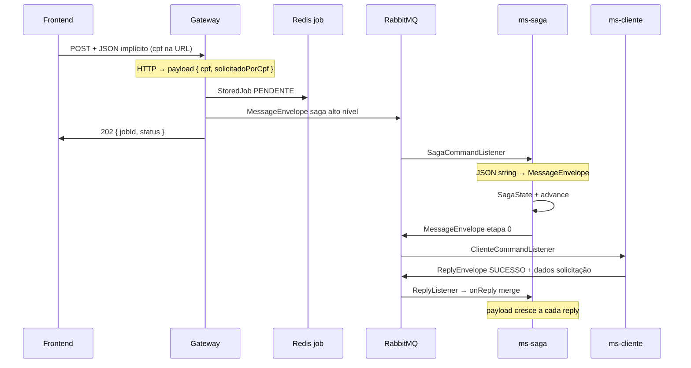

# 7. Fluxos de informação e transformação de formatos

[← Voltar ao índice](./README.md) · [ms-saga](./05-pastas-ms-saga.md) · [Gateway](./06-pastas-gateway.md)

Este tutorial responde, em um só lugar:

- **Quem entrega** dados, **para quem**, **como** (protocolo/fila/função) e **por quê**.
- **Como o formato muda** em cada salto (HTTP → Redis → AMQP → reply → job).

Use junto com [01-visao-geral.md](./01-visao-geral.md) e [02-fluxo-aprovar-cliente.md](./02-fluxo-aprovar-cliente.md).

---

## 7.1 Atores e responsabilidades

| Ator | Entrega | Recebe | Motivo |
|------|---------|--------|--------|
| **Frontend** | HTTP JSON + `x-access-token` | 202 + `Location` ou JSON síncrono | UX |
| **Gateway** | `MessageEnvelope` em `saga.cmd` **ou** HTTP aos MSs | Respostas REST / nada (fire-and-forget AMQP) | Borda única, auth, jobs |
| **ms-saga** | `MessageEnvelope` em `ms.*.cmd` | `ReplyEnvelope` em `orquestrador.reply` | Orquestração + merge de payload |
| **Microserviço** | `ReplyEnvelope` (se transactional) | `MessageEnvelope` na fila do domínio | Executa um comando atômico |
| **Redis** | — | GET/SET de `job:*` e `saga:*` | Correlação e polling |
| **RabbitMQ** | Rotear buffers | Consumers | Desacoplamento e retry/DLQ |

---

## 7.2 Tipos de mensagem (contrato estável)

Definições canônicas JVM: módulo [`shared/amqp`](../backend/services/shared/src/main/kotlin/br/ufpr/dac/bantads/shared/amqp/).  
Espelho TypeScript: [`gateway/src/types/envelopes.ts`](../backend/gateway/src/types/envelopes.ts).

### `MessageEnvelope` (comando — ida)

| Campo | Significado | Quem preenche |
|-------|-------------|---------------|
| `sagaId` | = `jobId` | Gateway (início) ou saga (etapas seguintes) |
| `tipo` | Saga de alto nível **ou** comando atômico (`cliente.criar`) | Gateway vs `SagaEngine.advance` |
| `timestamp` | ISO-8601 | Quem publica |
| `payload` | `Map` JSON acumulativo | Gateway (inicial); saga repassa enriquecido |

### `ReplyEnvelope` (resposta — volta)

| Campo | Significado | Quem preenche |
|-------|-------------|---------------|
| `sagaId` | Correlação | Microserviço (listener) |
| `tipo` | Mesmo `tipo` do comando executado | MS |
| `status` | `SUCESSO` \| `FALHA` | MS |
| `erro` | Texto se falhou | MS |
| `payload` | **Somente campos novos** | MS (handler) |

**Regra de merge (ms-saga):** `novoPayload = antigo + reply.payload` (sem chaves `senha` persistidas — ver `withoutPassword()` e `SagaSecrets`).

### Job no Redis (HTTP ↔ cliente)

| Campo | Quando aparece |
|-------|----------------|
| `jobId`, `status`, `cpf` | Gateway ao aceitar saga |
| `erro` | Falha publish ou saga `failJob` |
| `resultType`, `resultado`, `dominio`, `resourceId` | Saga `complete` (quando expõe resultado inline) |

Funções Gateway: [`saveJob` / `readJob` / `jobStatusBody`](../backend/gateway/src/redis/jobs.ts).  
Funções saga: `JobStore` + `SagaEngine.complete` / `failJob`.

---

## 7.3 Linha do tempo: uma saga (exemplo `aprovar-cliente`)

**Por quê três “formatos” seguidos no início?**

1. **HTTP:** REST com path param `cpf` — conveniente para o Angular.
2. **Redis job:** documento pequeno para polling (sem vazar payload inteiro da saga).
3. **AMQP:** envelope padronizado para todos os participantes JVM.

---

## 7.4 Tabela: salto → função → transformação

| # | De → Para | Função / listener | Transformação |
|---|-----------|-------------------|---------------|
| 1 | Cliente → Gateway | `registerAprovacao` | `cpf` (path) + `request.user.cpf` → `payload` |
| 2 | Gateway → Redis | `saveJob` | Objeto TS → `JSON.stringify` em `job:{uuid}` |
| 3 | Gateway → Rabbit | `connectRabbitPublisher.publish` | `MessageEnvelope` → Buffer JSON, fila `saga.cmd` |
| 4 | Rabbit → Saga | `SagaCommandListener.onCommand` | `String` → `MessageEnvelope` |
| 5 | Saga → Redis | `RedisSagaStateStore.save` | `SagaState` → JSON em `saga:{id}` |
| 6 | Saga → Rabbit | `RabbitCommandBus.publish` | Novo envelope: `tipo` = comando da etapa, `payload` mesclado |
| 7 | MS → Rabbit | `*CommandListener` (ex. cliente) | Domínio → `ReplyEnvelope` |
| 8 | Rabbit → Saga | `ReplyListener.onReply` | Merge payload; `etapaAtual++`; `advance` |
| 9 | Saga → Redis job | `RedisJobStore` via engine | Atualiza `status`, opcional `resultado` |
| 10 | Cliente → Gateway | `registerJobs` | `readJob` → `jobStatusBody` (subset de campos) |

---

## 7.5 Evolução do `payload` na R9 (resumo)

Estado após cada **reply com sucesso** (campos principais — ver código dos handlers para lista exata).

| Após etapa (`tipo`) | Campos típicos acrescentados ao payload global |
|---------------------|------------------------------------------------|
| Início Gateway | `cpf`, `solicitadoPorCpf` |
| `cliente.marcar-aprovada` | nome, email, endereço, salário, flags da solicitação |
| `gerente.listar-ativos` | `gerentes` (lista) |
| `conta.escolher-gerente-menos-clientes` | `cpfGerente` |
| `cliente.criar` | confirmação / ids cliente |
| `auth.criar-cliente` | metadados auth; **senha** vai para `SagaSecrets`, não ao Redis de estado |
| `conta.criar` | `numeroConta`, etc. |
| `email.senha-cliente` | (sem reply — FIRE_AND_FORGET) |

O **ms-saga** usa esse mapa monolítico nas etapas seguintes; cada MS vê só o JSON da mensagem, não o histórico HTTP.

---

## 7.6 Caminho síncrono (proxy) — formato diferente

| Aspecto | Saga | Proxy (`routes/proxy.ts`) |
|---------|------|---------------------------|
| Transporte | RabbitMQ | HTTP `fetch` |
| Corpo | `MessageEnvelope` | JSON de domínio direto |
| Correlação | `sagaId` | Sem job; status HTTP imediato |
| Identidade | Implícita no payload inicial | Headers `X-User-CPF`, `X-User-Tipo` |
| Cache | Invalidado pelo saga ao concluir | [`redis/cache.ts`](../backend/gateway/src/redis/cache.ts) em GETs |

**Por quê dois modelos?** Nem toda operação precisa de compensação multi-MS; proxy mantém latência baixa e contratos REST simples.

---

## 7.7 Falhas: o que muda no formato

| Evento | Quem detecta | Formato exposto ao cliente |
|--------|--------------|----------------------------|
| Publish Rabbit falhou | Gateway `catch` em rota saga | Job Redis `FALHA`, `erro: "Falha ao publicar SAGA"` |
| `ReplyEnvelope.status = FALHA` | `SagaEngine.onReply` | Compensação; job final `FALHA` + `erro` |
| Timeout transactional | `TimeoutScanner` | Mesmo que falha (motivo `timeout`) |
| Mensagem na DLQ | `DlqListener` | `onDlq` → compensação (`erro` DLQ) |

Detalhes: [03-rollback-e-falhas.md](./03-rollback-e-falhas.md).

---

## 7.8 Checklist para depuração

1. **O job existe no Redis?** Chave `job:{uuid}` — quem escreveu primeiro foi o Gateway.
2. **A saga existe?** Chave `saga:{uuid}` — só ms-saga.
3. **Último comando esperado?** Campo `waitingTipo` em `SagaState`.
4. **Payload atual?** JSON em `saga:{uuid}` — deve crescer após cada SUCESSO.
5. **Filas?** `saga.cmd` (uma msg do GW), depois `ms.*.cmd` / `orquestrador.reply` alternando.

---

## 7.9 Onde cada pasta encaixa neste fluxo

| Etapa do fluxo | ms-saga (pastas) | Gateway (pastas) |
|----------------|------------------|------------------|
| Autenticação | — | `auth/`, `redis/session` |
| Disparo saga | `amqp` listener | `routes/`, `amqp/`, `types/` |
| Orquestração | `engine/` | — |
| Persistência | `store/` | `redis/jobs` |
| Consulta status | `store/` + `job/` | `routes/jobs` |
| Leitura REST direta | — | `routes/proxy`, `http/` |

Documentação por pasta: [05-pastas-ms-saga.md](./05-pastas-ms-saga.md), [06-pastas-gateway.md](./06-pastas-gateway.md).