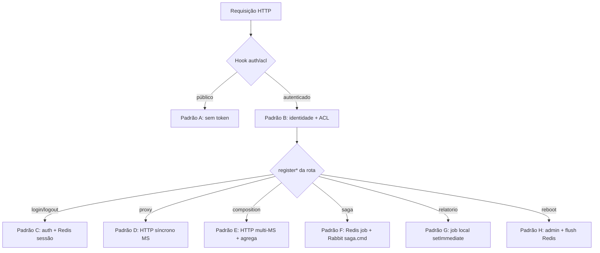
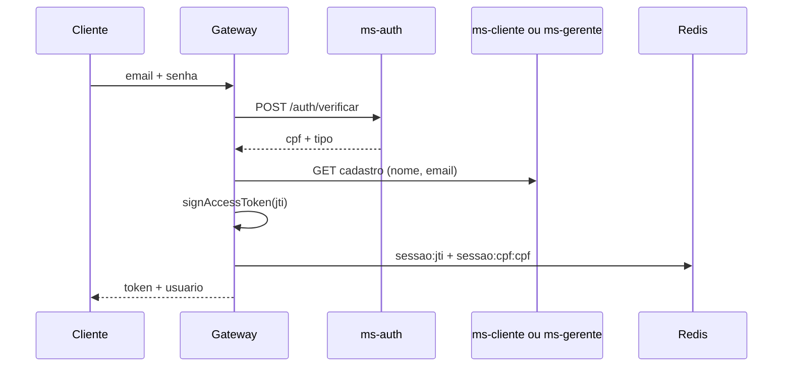

# 8. Gateway — tipos de fluxo (visão transversal)

[← Voltar ao índice](./README.md) · [Autenticação](./09-gateway-autenticacao-acl.md) · [Redis](./10-gateway-redis.md) · [Catálogo de rotas](./11-gateway-catalogo-funcionalidades.md)

O Gateway **não é um único pipeline**: cada rota usa um **padrão de execução** diferente. Este documento classifica todos os padrões para você saber *onde olhar no código* quando algo falha.

---

## 8.1 Os seis padrões de execução

| Padrão | O que faz | Redis | Rabbit | Arquivos principais |
|--------|-----------|-------|--------|---------------------|
| **A** Público | Responde sem `x-access-token` | Opcional (reboot limpa) | Não | `auth/acl.ts`, `app.ts` health |
| **B** Hook global | Valida JWT + sessão + perfil | Sessão / revogação | Não | `auth/hook.ts` |
| **C** Login/Logout | Troca credenciais por token | Cria/apaga sessão | Não | `routes/login.ts`, `logout.ts` |
| **D** Proxy direto | 1 HTTP → 1 MS | Cache em GET cadastro | Não | `routes/proxy.ts` |
| **E** Composição | N≥2 HTTP → JSON único | Não (só cache nos GET unitários) | Não | `routes/composition.ts`, partes do proxy |
| **F** Saga | Aceita 202, trabalho assíncrono | Job `PENDENTE` | `saga.cmd` | `routes/aprovacao.ts`, `amqp/publisher.ts` |
| **G** Relatório async | 202 + trabalho no processo GW | Job atualizado no fim | Não | `routes/relatorio.ts` |
| **H** Reboot dev | Reset ambiente de teste | `FLUSHDB` | Não | `routes/reboot.ts` |

**Leitura complementar por pasta:** [06-pastas-gateway.md](./06-pastas-gateway.md).

---

## 8.2 Padrão A — rotas públicas

**Por quê existem?** Autocadastro e healthcheck não podem exigir login prévio.

| Método | Caminho | Handler | Destino |
|--------|---------|---------|---------|
| `GET` | `/health` | `app.ts` | JSON `{ status: 'UP' }` |
| `POST` | `/login` | `login.ts` | ms-auth → sessão (ver doc 09) |
| `POST` | `/reboot` | `reboot.ts` | MSs `/internal/reboot` |
| `POST` | `/solicitacoes` | `proxy.ts` → cliente | Autocadastro |

Definição: [`isPublicRoute`](../backend/gateway/src/auth/acl.ts) — o hook **retorna cedo** e não preenche `request.user`.

---

## 8.3 Padrão B — todo o resto passa pelo hook

Fluxo em [`registerAuthHook`](../backend/gateway/src/auth/hook.ts):

1. OPTIONS → libera (CORS).
2. Rota pública → libera.
3. Exige header `x-access-token`.
4. `verifyAccessToken` → `cpf`, `tipo`, `jti`, `exp`.
5. `isRevoked(jti)` — logout anterior.
6. `readSession(jti)` — sessão ainda existe no Redis.
7. `touchSession` — renova TTL (30 min).
8. `accessFor(method, path)` + `isAllowed` — **403** se perfil errado.
9. Rota desconhecida na ACL → **404** (não vaza existência).

Depois disso a rota específica roda com `request.user` preenchido.

---

## 8.4 Padrão C — login e logout

### Login (`POST /login`)

**Por quê buscar cliente/gerente depois do auth?** O contrato HTTP do login devolve **dados de perfil** para o frontend; o auth só valida senha.

### Logout (`POST /logout`)

- Exige passar pelo hook (padrão B) — precisa de token válido.
- `revokeSession`: apaga sessão, marca `revogado:jti` até expirar o JWT.
- Resposta **204** sem corpo.

Detalhes das chaves: [10-gateway-redis.md](./10-gateway-redis.md#102-sessões).

---

## 8.5 Padrão D — proxy HTTP síncrono

Funções centrais em [`proxy.ts`](../backend/gateway/src/routes/proxy.ts):

| Função | Papel |
|--------|-------|
| `identityHeaders` | Propaga `X-User-CPF` e `X-User-Tipo` para o MS confiar na identidade |
| `forward` | `msRequest` com método/corpo originais |
| `sendForwarded` | Repassa status + body; reescreve `Location` e `_links` para URL pública |
| `cachedGet` | GET com cache Redis antes de ir ao MS |
| `transferir` | Orquestração **local** (não saga): valida destino, monta nomes, POST transferência |

**Transformação de dados:** corpo HTTP do cliente ≈ corpo HTTP no MS (exceto transferência, que enriquece com nomes).

**Por quê headers de identidade em vez de reenviar o JWT?** Os microserviços Spring confiam na rede interna; o Gateway é a fronteira de autenticação.

---

## 8.6 Padrão E — composição (BFF)

Usado quando **nenhum MS** expõe o JSON que o frontend precisa.

| Endpoint | Funções | Chamadas MS |
|----------|---------|-------------|
| `GET /clientes` | `listarClientes` | cliente + `/internal/saldos` (com retry) |
| `GET /gerentes` | `listarGerentes` | gerente + `/internal/contagem-por-gerente` |
| `GET /relatorios/clientes` (dados) | `collectRelatorioClientes` | cliente + saldos + gerentes em paralelo |

**Por quê no Gateway e não no ms-cliente?** Evita acoplamento entre bounded contexts; o GW já conhece URLs de todos os MSs (`config.ts`).

**Erros específicos:**

- `502` — cadastro sem cidade/UF na listagem.
- `503` — saldo ainda não projetado após 3 tentativas (`SALDO_TENTATIVAS`).

Arquivo: [`composition.ts`](../backend/gateway/src/routes/composition.ts).

---

## 8.7 Padrão F — sagas (RabbitMQ)

Rotas que **só** aceitam e disparam; conclusão via job:

| Rota | `tipo` saga |
|------|-------------|
| `POST /solicitacoes/:cpf/aprovacao` | `aprovar-cliente` |
| `POST /gerentes` | `inserir-gerente` |
| `DELETE /gerentes/:cpf` | `remover-gerente` |

Fluxo idêntico em cada arquivo:

1. Validar entrada.
2. `saveJob` `PENDENTE` + `cpf` do gerente autenticado.
3. `publisher.publish(MessageEnvelope)`.
4. **202** + `Location: /jobs/.../status`.

O ms-saga **atualiza** o mesmo job e pode invalidar cache/sessão no Redis remoto ([`RedisCacheInvalidator`](../backend/services/saga/src/main/kotlin/br/ufpr/dac/bantads/saga/store/RedisCacheInvalidator.kt)).

---

## 8.8 Padrão G — relatório (job sem Rabbit)

[`relatorio.ts`](../backend/gateway/src/routes/relatorio.ts):

1. Cria job `PENDENTE` (mesmo formato que saga).
2. Responde **202** imediatamente.
3. `setImmediate` → `runRelatorio` no **mesmo processo** Node.
4. Sucesso: job `CONCLUIDO`, `resultType: INLINE`, `resultado` = JSON composto.
5. Falha: job `FALHA` + `erro`.

**Por quê não usar saga?** Operação read-only agregada; compensação não se aplica. Ainda assim reutiliza **polling** de jobs para UX igual às sagas.

Consulta: `GET /jobs/:id/result` quando `CONCLUIDO` + `INLINE`.

---

## 8.9 Padrão H — reboot

`POST /reboot` (público):

1. Limpa arquivo opcional de senha recente (dev).
2. `POST /internal/reboot` em auth, cliente, gerente, conta (paralelo).
3. `store.flushdb()` — **zera todo o Redis do Gateway** (jobs, sessões, cache).
4. Resposta com contagens de seed.

**Por quê flush Redis?** Testes de contrato precisam de estado limpo; sessões e jobs antigos invalidariam cenários.

---

## 8.10 Padrão I — consulta de jobs

[`jobs.ts`](../backend/gateway/src/routes/jobs.ts) — somente leitura Redis:

| Rota | Condição | Resposta |
|------|----------|----------|
| `GET /jobs/:id/status` | job existe e `cpf` = usuário | subset via `jobStatusBody` |
| `GET /jobs/:id/result` | `CONCLUIDO` + `INLINE` | `resultado` completo |

**Por quê checar `job.cpf`?** Impede um gerente de vazar status de job de outro.

Origens de jobs: sagas (F), relatório (G), falha de publish no Gateway.

---

## 8.11 Matriz: funcionalidade × tecnologia

| Funcionalidade | Auth | Redis | Rabbit | MS HTTP |
|----------------|------|-------|--------|---------|
| Health | — | — | — | — |
| Login/Logout | ✓ | sessão | — | auth + cliente/gerente |
| Autocadastro solicitação | público | — | — | cliente |
| Listar/aprovar/rejeitar solicitações | gerente | — | — | cliente |
| Aprovar cliente | gerente | job | ✓ | — |
| CRUD proxy cliente/conta | ACL | cache GET | — | cliente/conta |
| Listagens compostas | gerente | — | — | vários |
| Transferência | cliente | — | — | conta + cliente |
| Inserir/remover gerente | gerente | job | ✓ | — |
| Relatório clientes | gerente | job | — | vários |
| Reboot | público | flush | — | todos |
| Jobs status/result | auth + owner | read | — | — |

Catálogo endpoint a endpoint: [11-gateway-catalogo-funcionalidades.md](./11-gateway-catalogo-funcionalidades.md).

---

## 8.12 Ordem de leitura recomendada

1. Este doc (qual padrão a rota usa).
2. [09-gateway-autenticacao-acl.md](./09-gateway-autenticacao-acl.md) — antes de debugar 401/403.
3. [10-gateway-redis.md](./10-gateway-redis.md) — jobs, sessão, cache, quem escreve.
4. [11-gateway-catalogo-funcionalidades.md](./11-gateway-catalogo-funcionalidades.md) — referência rápida.
5. Sagas no barramento: [07-fluxos-e-formatos.md](./07-fluxos-e-formatos.md).