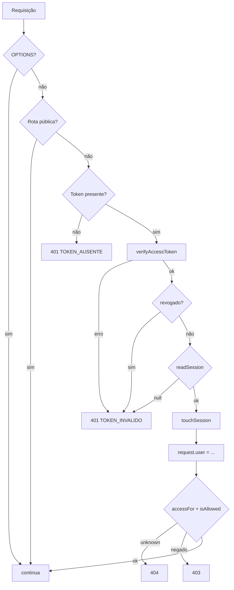

# 9. Gateway — autenticação e ACL

[← Voltar ao índice](./README.md) · [Tipos de fluxo](./08-gateway-tipos-de-fluxo.md) · [Redis sessões](./10-gateway-redis.md#102-sessões)

Este tutorial explica **como o Gateway autentica**, **por que** há JWT **e** Redis juntos, e **como cada rota** é autorizada.

---

## 9.1 Peças envolvidas

| Peça | Arquivo | Responsabilidade |
|------|---------|------------------|
| JWT | [`auth/jwt.ts`](../backend/gateway/src/auth/jwt.ts) | Assinar/validar claims `cpf`, `tipo`, `jti`, `exp` (8h) |
| ACL | [`auth/acl.ts`](../backend/gateway/src/auth/acl.ts) | Mapear rota → perfil necessário |
| Hook | [`auth/hook.ts`](../backend/gateway/src/auth/hook.ts) | Aplicar JWT + sessão + ACL em **toda** requisição não pública |
| Login | [`routes/login.ts`](../backend/gateway/src/routes/login.ts) | Obter token |
| Logout | [`routes/logout.ts`](../backend/gateway/src/routes/logout.ts) | Invalidar sessão |
| Sessão Redis | [`redis/session.ts`](../backend/gateway/src/redis/session.ts) | Estado server-side do login |
| Tipo `request.user` | [`types/fastify.ts`](../backend/gateway/src/types/fastify.ts) | `GatewayUser` após hook |

---

## 9.2 Por que JWT + Redis (e não só JWT)?

| Só JWT | JWT + Redis (este projeto) |
|--------|---------------------------|
| Logout só “esquecendo” token no cliente | `revokeSession` impede reuso até expirar |
| Sem lista de sessões ativas | `sessao:cpf:{cpf}` aponta para `jti` atual |
| Saga pode remover gerente ainda logado | ms-saga `deleteSessions(cpf)` limpa chaves |

O token continua **stateless** para o cliente (envia em todo request), mas o servidor **confirma** que a sessão não foi revogada e ainda existe em Redis.

TTL da sessão: **30 min** de inatividade renovável (`SESSION_TTL_SECONDS`); JWT dura **8h** (`JWT_EXPIRES_IN`). Se a sessão expirar no Redis, o hook falha mesmo com JWT válido.

---

## 9.3 Fluxo do hook (`onRequest`)



Código: [`hook.ts`](../backend/gateway/src/auth/hook.ts).

**Por quê 404 para rota desconhecida na ACL?** Rotas não registradas no mapa de acesso são tratadas como inexistentes para usuários autenticados (evita enumeração).

---

## 9.4 Login passo a passo

1. **Validação Zod** — `loginInputSchema` (`email`, `senha`).
2. **ms-auth** — `POST {authUrl}/auth/verificar` com credenciais.
3. **Resposta auth** — extrai `cpf` e `tipo` (`CLIENTE` | `GERENTE`).
4. **Enriquecimento** — `loadUsuario`: GET `/clientes/{cpf}` ou `/gerentes/{cpf}` com headers de identidade.
5. **Token** — `jti = randomUUID()`, `signAccessToken`, lê `exp` do payload.
6. **Redis** — `createSession(store, { cpf, tipo, jti, exp })`.
7. **Resposta HTTP:**

```json
{
  "auth": true,
  "token": "<JWT>",
  "tipo": "GERENTE",
  "usuario": { "cpf", "nome", "email" }
}
```

**Quem recebe o quê:**

| Destinatário | Dado | Formato |
|--------------|------|---------|
| Cliente (browser) | JWT string | Header `x-access-token` nas próximas chamadas |
| Redis | `sessao:{jti}` | JSON `SessionRecord` |
| Redis | `sessao:cpf:{cpf}` | string `jti` |

**Nota de design** ([comentário no código](../backend/gateway/src/redis/session.ts)): novo login **não** apaga `sessao:{jti}` antigo automaticamente — evita que testes com múltiplos tokens na mesma bateria quebrem. Logout explícito revoga só aquele `jti`.

---

## 9.5 Logout passo a passo

1. Hook já validou token → `request.user`.
2. `revokeSession(store, user, nowSeconds)`:
   - `DEL sessao:{jti}`, `DEL sessao:cpf:{cpf}`
   - `SET revogado:{jti} = "1"` com TTL = tempo restante do JWT
3. **204** sem corpo.

**Por quê manter `revogado:jti`?** O JWT ainda é válido criptograficamente até `exp`; a blacklist impede uso após logout.

---

## 9.6 ACL — perfis e regras

Tipos de acesso em [`acl.ts`](../backend/gateway/src/auth/acl.ts):

| `Access.kind` | Significado |
|---------------|-------------|
| `public` | Sem autenticação (lista fixa) |
| `auth` | Qualquer usuário logado (logout, jobs) |
| `gerente` | `user.tipo === GERENTE` |
| `cliente` | `user.tipo === CLIENTE` |
| `gerenteOrSelf` | Gerente vê tudo; cliente só se CPF no path = `user.cpf` |

### Rotas públicas (não passam pelo restante do hook)

- `GET /health`
- `POST /login`
- `POST /reboot`
- `POST /solicitacoes` (autocadastro)

### Regras destacadas

| Padrão de path | Acesso | Motivo de negócio |
|----------------|--------|-------------------|
| `/jobs/*` | `auth` + ownership no handler | Polling assíncrono |
| `/solicitacoes/*` (exceto POST raiz) | `gerente` | Fila de aprovação |
| `POST .../aprovacao` | `gerente` | Dispara saga |
| `GET /clientes` | `gerente` | Lista agregada |
| `GET /clientes/:cpf` | `gerenteOrSelf` | Cliente vê só o próprio cadastro |
| `POST /contas/:n/deposito|saque|transferencia` | `cliente` | Operação bancária |
| `GET /contas/:n`, `/extrato` | `gerenteOrSelf` | Extrato próprio ou visão gerente |

Função `selfCpfFromPath` extrai CPF de `/clientes/{cpf}` para comparar com o usuário.

**Regra extra fora da ACL:** `DELETE /gerentes/:cpf` bloqueia se `user.cpf === cpf` alvo ([`remover-gerente.ts`](../backend/gateway/src/routes/remover-gerente.ts)) — não pode remover a si mesmo.

---

## 9.7 Como a identidade chega nos microserviços

Depois do hook, rotas HTTP usam:

```typescript
headers['X-User-CPF'] = user.cpf;
headers['X-User-Tipo'] = user.tipo;
```

Funções: `identityHeaders` (proxy) e `identityHeadersFrom` (composition, relatorio).

**Por quê não encaminhar o JWT?** Contrato interno do BANTADS: MSs validam identidade via headers confiáveis na rede Docker. O Gateway é o único componente exposto à internet.

---

## 9.8 Erros de autenticação (formato HTTP)

Corpo padrão [`authError`](../backend/gateway/src/http/errors.ts):

```json
{
  "auth": false,
  "message": "<AuthMessages>"
}
```

Mensagens em [`types/enums.ts`](../backend/gateway/src/types/enums.ts): `TOKEN_AUSENTE`, `TOKEN_INVALIDO`, `LOGIN_INVALIDO`.

Erros de autorização de negócio usam [`Erros.forbidden()`](../backend/gateway/src/http/errors.ts) com `status`, `erro`, `mensagem`.

---

## 9.9 Interação com sagas e invalidação remota

Quando uma saga remove gerente ou aprova cliente, o **ms-saga** pode chamar [`RedisCacheInvalidator.deleteSessions`](../backend/services/saga/src/main/kotlin/br/ufpr/dac/bantads/saga/store/RedisCacheInvalidator.kt) no **mesmo** Redis.

Efeito: próximo request com JWT antigo → `readSession` retorna null → **401**, forçando novo login.

Isso conecta autenticação Gateway ↔ orquestração; ver [10-gateway-redis.md](./10-gateway-redis.md#106-quem-escreve-em-cada-chave).

---

## 9.10 Checklist de depuração (401/403)

1. Rota é pública? → não precisa token.
2. Header `x-access-token` presente?
3. JWT válido e não expirado?
4. `GET revogado:{jti}` existe?
5. `GET sessao:{jti}` existe e JSON ok?
6. `accessFor` — perfil correto? Cliente acessando CPF alheio em `gerenteOrSelf`?
7. Jobs — `job.cpf` bate com usuário? (403 no handler, não no hook)