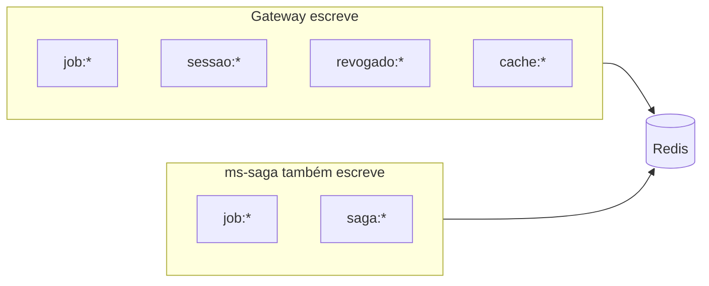

# 10. Gateway — Redis: sub-tarefas e responsabilidades

[← Voltar ao índice](./README.md) · [Tipos de fluxo](./08-gateway-tipos-de-fluxo.md) · [Auth](./09-gateway-autenticacao-acl.md)

O Gateway usa **um** Redis (`REDIS_URL`) para **quatro famílias de dados**. O ms-saga e o Gateway compartilham esse banco para **jobs** e invalidação de **cache/sessão**.

Implementação: [`redis/redis-store.ts`](../backend/gateway/src/redis/redis-store.ts) (`get`, `set`+TTL, `del`, `expire`, `flushdb`).

---

## 10.1 Visão geral das famílias



| Prefixo | Sub-tarefa | TTL padrão | Módulo GW |
|---------|------------|------------|-----------|
| `job:` | Rastrear trabalho assíncrono | 5 min | [`redis/jobs.ts`](../backend/gateway/src/redis/jobs.ts) |
| `sessao:` | Sessão ativa por token | 30 min (renovável) | [`redis/session.ts`](../backend/gateway/src/redis/session.ts) |
| `revogado:` | Blacklist pós-logout | até exp do JWT | [`redis/session.ts`](../backend/gateway/src/redis/session.ts) |
| `cache:` | Cache de cadastro GET | 5 min | [`redis/cache.ts`](../backend/gateway/src/redis/cache.ts) |

Constantes: [`config.ts`](../backend/gateway/src/config.ts) — `JOB_TTL_SECONDS`, `SESSION_TTL_SECONDS`, `CACHE_TTL_SECONDS`.

**Por quê TTL em tudo?** Evita crescimento infinito e dados obsoletos após reboot parcial.

---

## 10.2 Sessões

### Chaves

| Chave | Valor | Quem cria | Quem lê | Por quê |
|-------|-------|-----------|---------|---------|
| `sessao:{jti}` | `{"cpf","tipo","expJwt"}` | `createSession` (login) | `readSession` (hook) | Prova server-side que o login foi feito neste GW |
| `sessao:cpf:{cpf}` | `jti` (string) | `createSession` | ms-saga `deleteSessions` | Achar sessão para invalidar após saga |
| `revogado:{jti}` | `"1"` | `revokeSession` (logout) | `isRevoked` (hook) | Token ainda válido em JWT mas morto no servidor |

### Operações

| Função | Quando | Efeito |
|--------|--------|--------|
| `createSession` | Login OK | SET duas chaves com TTL 30 min |
| `touchSession` | Cada request autenticado | EXPIRE renova 30 min |
| `revokeSession` | Logout | DEL sessão + SET revogado |
| `readSession` | Hook | Parse JSON ou null → 401 |
| `isRevoked` | Hook antes da sessão | GET revogado |

**Transformação:** objeto `GatewayUser` parcial → JSON `SessionRecord` (sem guardar senha nem token completo).

---

## 10.3 Jobs assíncronos

### Modelo `StoredJob`

Definido em [`redis/jobs.ts`](../backend/gateway/src/redis/jobs.ts):

```typescript
{
  jobId, status, cpf?,
  resultType?, dominio?, resourceId?,
  resultado?, erro?
}
```

### Chave

`job:{jobId}` — string JSON, TTL **5 minutos** (`JOB_TTL_SECONDS`).

### Quem escreve e quando

| Evento | Writer | Campos típicos |
|--------|--------|----------------|
| Saga aceita (202) | Gateway `saveJob` | `PENDENTE`, `cpf` do dono |
| Publish Rabbit falhou | Gateway | `FALHA`, `erro: Falha ao publicar SAGA` |
| Relatório iniciado | Gateway | `PENDENTE` |
| Relatório terminou | Gateway `runRelatorio` | `CONCLUIDO` + `resultType: INLINE` + `resultado` |
| Saga conclui / falha | **ms-saga** `RedisJobStore` | `CONCLUIDO` / `FALHA`, `dominio`, `resourceId`, etc. |

**Por quê o mesmo formato Gateway e saga?** O cliente só fala com o Gateway (`GET /jobs/...`); o orquestrador atualiza a mesma chave.

### Leitura

| Função | Uso |
|--------|-----|
| `readJob` | `jobs.ts` — status e result |
| `jobStatusBody` | Remove campos internos; expõe subset no status |

**Segurança:** `isJobOwner` — job sem `cpf` ou CPF diferente → 403 (jobs antigos ou malformados negados).

---

## 10.4 Cache de cadastro

### Chaves

- `cache:cliente:{cpf}`
- `cache:gerente:{cpf}`

### Fluxo `cachedGet` ([`proxy.ts`](../backend/gateway/src/routes/proxy.ts))

1. `readCache` → hit: responde 200 com HATEOAS (sem ir ao MS).
2. Miss: `forward` ao MS.
3. Se 200: `cacheableCadastro` normaliza body + `writeCache`.
4. Resposta com HATEOAS.

**Por quê cache só em GET por CPF?** Cadastro individual muda pouco; listagens compostas (`GET /clientes`) **não** usam cache (dados agregados mudam com saldo).

### Invalidação

| Quem | Como |
|------|------|
| Gateway | `PUT /gerentes/:cpf` → `del(gerenteCacheKey)` se 200 |
| ms-saga | `RedisCacheInvalidator.deleteCliente/Gerente` após saga |
| Reboot | `flushdb` apaga tudo |

TTL 5 min (`CACHE_TTL_SECONDS`) é fallback se invalidação falhar.

---

## 10.5 Operação especial: `flushdb`

Só [`reboot.ts`](../backend/gateway/src/routes/reboot.ts) chama `store.flushdb()`.

**Apaga:** todas as sessões, jobs, caches, revogados — **e** chaves `saga:*` do ms-saga no mesmo DB.

**Por quê após reboot dos MSs?** Ambiente de desenvolvimento/teste volta ao estado consistente.

---

## 10.6 Quem escreve em cada chave (matriz)

| Chave | Gateway | ms-saga |
|-------|---------|---------|
| `job:*` | Cria PENDENTE; relatório atualiza | Atualiza ao completar saga |
| `sessao:*` | Login, logout, touch | `deleteSessions` |
| `revogado:*` | Logout | — |
| `cache:*` | GET cache, PUT gerente del | `deleteCliente`, `deleteGerente` |
| `saga:*` | — | Estado orquestração (não usado pelo GW HTTP) |

---

## 10.7 Fluxos Redis por padrão de rota

Ligação com [08-gateway-tipos-de-fluxo.md](./08-gateway-tipos-de-fluxo.md):

| Padrão | Operações Redis |
|--------|-----------------|
| Login | `createSession` (2 SET) |
| Request autenticado | `touchSession` (2 EXPIRE) |
| Logout | `revokeSession` (DEL + SET) |
| Saga / relatório 202 | `saveJob` |
| Poll job | `readJob` |
| GET cliente/gerente CPF | `readCache` / `writeCache` |
| Reboot | `flushdb` |

**Rabbit não passa pelo Redis no Gateway** — só o **resultado** da saga volta via job.

---

## 10.8 Formato dos valores no fio

| Camada TypeScript | Persistência |
|-------------------|--------------|
| `StoredJob` | `JSON.stringify` |
| `SessionRecord` | `JSON.stringify` |
| Cache cadastro | JSON do body normalizado (objeto) |
| `revogado` | string literal `"1"` |

Leitura sempre com `JSON.parse` + tratamento de corrupção (`readJob` / `readCache` deletam chave inválida).

---

## 10.9 Por que não usar Redis para tudo?

| Dado | Onde fica | Motivo |
|------|-----------|--------|
| Estado da saga (etapa, payload merge) | `saga:{id}` no ms-saga | Lógica vive no orquestrador |
| Sessão de login | Redis GW | Revogação centralizada |
| Cache cadastro | Redis GW | Latência de leitura frequent |
| Job | Redis compartilhado | Contrato único de polling |

---

## 10.10 Comandos úteis (dev)

Inspecionar sem abrir o código:

```bash
redis-cli GET "job:<uuid>"
redis-cli GET "sessao:<jti>"
redis-cli TTL "cache:cliente:12345678901"
```

Após `POST /reboot`, `DBSIZE` deve cair para zero (no database usado pelo compose).