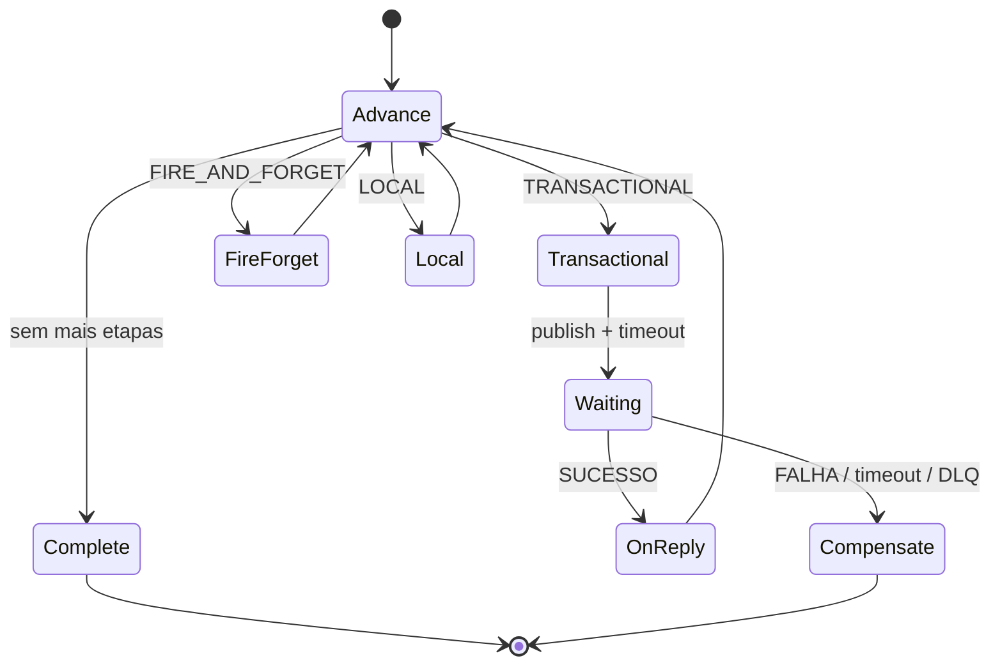

# 12. ms-saga — tipos de fluxo assíncrono

[← Voltar ao índice](./README.md) · [R9](./02-fluxo-aprovar-cliente.md) · [R13](./13-fluxo-inserir-gerente.md) · [R15](./14-fluxo-remover-gerente.md) · [echo](./15-fluxo-echo.md)

**Resposta direta:** os docs 01–03 e 05–07 focam em **visão geral** e na saga **`aprovar-cliente` (R9)**. **Não** havia tutoriais dedicados a **R13**, **R15**, **echo** nem uma matriz dos **modos de execução** dentro do `SagaEngine`. Este documento unifica isso; os fluxos de negócio completos estão nos docs 13–15.

---

## 12.1 Quatro receitas registradas

Fonte única: [`SagaRegistry.kt`](../backend/services/saga/src/main/kotlin/br/ufpr/dac/bantads/saga/engine/SagaRegistry.kt).

| `tipo` (saga) | HTTP (Gateway) | Requisito | Doc passo a passo |
|---------------|----------------|-----------|-------------------|
| `aprovar-cliente` | `POST /solicitacoes/:cpf/aprovacao` | R9 | [02](./02-fluxo-aprovar-cliente.md) |
| `inserir-gerente` | `POST /gerentes` | R13 | [13](./13-fluxo-inserir-gerente.md) |
| `remover-gerente` | `DELETE /gerentes/:cpf` | R15 | [14](./14-fluxo-remover-gerente.md) |
| `echo` | (testes / publicação direta em `saga.cmd`) | infra | [15](./15-fluxo-echo.md) |

Todas entram pelo mesmo canal: **`saga.cmd`** → `SagaCommandListener` → `SagaEngine.start`.

---

## 12.2 Três “motores” de avanço ( `StepKind` )

O assíncrono **não é homogêneo**: cada etapa usa um **modo** diferente em [`advance`](../backend/services/saga/src/main/kotlin/br/ufpr/dac/bantads/saga/engine/SagaEngine.kt#L124-L181).

| `StepKind` | Espera reply? | O que acontece no engine | Sagas que usam |
|------------|---------------|--------------------------|----------------|
| **TRANSACTIONAL** | Sim (`orquestrador.reply`) | `publish` → para com `waitingTipo` + deadline timeout | Quase todas as etapas de negócio |
| **FIRE_AND_FORGET** | Não | `publish` → incrementa `etapaAtual` → `advance` imediato | E-mails (`email.*`) |
| **LOCAL** | Não | `executeLocal` no JVM (Redis sessão, contador echo) | R15 `saga.invalidar-sessao`, echo `setup/undo` |



---

## 12.3 Quatro formas de “voltar” ou falhar (assíncrono de erro)

| Entrada | Listener / job | Método engine | Efeito |
|---------|----------------|---------------|--------|
| MS responde `FALHA` | `ReplyListener` | `onReply` → `compensate` | Comandos inversos + job `FALHA` |
| Sem reply a tempo | `TimeoutScanner` | `failTimedOutSteps` | Igual falha com `erro: timeout` |
| Mensagem vai para DLQ | `DlqListener` | `onDlq` | Compensa com `erro: DLQ` |
| Tipo de saga desconhecido | `SagaCommandListener` | `start` → `failJob` | Job falha sem estado |

Detalhes de compensação: [03-rollback-e-falhas.md](./03-rollback-e-falhas.md).

**Guarda:** `CompensationGuard` evita compensação duplicada (timeout + DLQ na mesma etapa) — ver teste `echo-to` em [`SagaEngineTest`](../backend/services/saga/src/test/kotlin/br/ufpr/dac/bantads/saga/engine/SagaEngineTest.kt).

---

## 12.4 Ramificações condicionais (`skipIfTrue`)

Algumas etapas **não rodam** se o payload tiver flag verdadeira — o engine **pula** sem publicar na fila.

| Saga | Flag no payload | Etapas puladas | Cenário |
|------|-------------------|----------------|---------|
| **R13** `inserir-gerente` | `semConta` | atribuir conta, obter clientes, e-mail troca | Banco sem conta livre para realocar |
| **R15** `remover-gerente` | `semContas` | obter clientes, e-mail troca | Gerente sem clientes/contas |

Origem da flag: reply de um MS anterior (ex. `conta.identificar-conta-para-novo-gerente` devolve `semConta: true`). Ver [13](./13-fluxo-inserir-gerente.md) e [14](./14-fluxo-remover-gerente.md).

---

## 12.5 Etapas **LOCAL** (assíncrono só no sentido da saga, sync no JVM)

| Comando | Saga | Função |
|---------|------|--------|
| `saga.invalidar-sessao` | R15 | `cache.deleteSessions(cpf)` — derruba login do gerente no Redis do Gateway |
| `echo.setup` | echo | Sem efeito colateral (só avança) |
| `echo.undo` | echo | Incrementa `compensacoes` no estado (teste de compensação local) |

**Por quê LOCAL em R15?** Invalidar sessão não precisa de MS; o saga já tem `CacheInvalidator` no Redis compartilhado.

---

## 12.6 Três desfechos de job (pós-`complete`)

[`SagaEngine.complete`](../backend/services/saga/src/main/kotlin/br/ufpr/dac/bantads/saga/engine/SagaEngine.kt#L394-L461) trata cada saga:

| Saga | `resultType` | Cliente HTTP usa |
|------|--------------|------------------|
| `aprovar-cliente` | **RESOURCE** | `dominio: clientes`, `resourceId: cpf` → link para cadastro |
| `inserir-gerente` | **RESOURCE** | `dominio: gerentes`, `resourceId: cpf` |
| `remover-gerente` | **INLINE** | `GET /jobs/:id/result` → mensagem com contagem de contas |
| `echo` | **INLINE** | `{ "mensagem": "pong" }` |

Em todas: `secrets.clear(sagaId)`; invalidação de cache conforme tipo (`deleteCliente` / `deleteGerente`).

---

## 12.7 Comparação rápida das sagas de negócio

| Aspecto | R9 aprovar | R13 inserir | R15 remover |
|---------|------------|-------------|-------------|
| MSs | cliente, gerente, conta, auth, email | gerente, auth, conta, cliente, email | gerente, auth, saga local, conta, cliente, email |
| EMAIL fire-and-forget | senha novo cliente | troca gerente (se contas) | troca gerente (se contas) |
| Senha no payload inicial | não (gerada no auth) | pode vir do GW; retirada do estado | — |
| Compensação especial e-mail duplicado | sim (R9 auth cliente) | sim (auth gerente) | — |
| E-mail de falha saga | `email.falha-aprovacao` | — | — |
| Sessão Gateway | não | não | invalida no meio do fluxo |

---

## 12.8 Linha do tempo genérica (qualquer saga)

```
Gateway: job PENDENTE + saga.cmd (tipo alto nível)
    → SagaEngine.start → SagaState EM_ANDAMENTO
    → loop advance:
         TRANSACTIONAL → ms.*.cmd → (aguarda) → orquestrador.reply → merge payload
         FIRE_AND_FORGET → ms.email.cmd (sem esperar)
         LOCAL → Redis / contador
    → complete → job CONCLUIDO (+ cache)
    OU compensate → comandos inversos → job FALHA
```

Correlação: **`sagaId` = `jobId`** em todas as mensagens.

---

## 12.9 O que permanece **síncrono** fora do ms-saga

O Gateway também tem **relatório** com job no Redis **sem** Rabbit ([08-gateway § 8.8](./08-gateway-tipos-de-fluxo.md#88-padrão-g--relatório-job-sem-rabbit)). Isso **não** passa pelo `SagaEngine` — só compartilha o modelo de polling de jobs.

---

## 12.10 Índice de leitura por saga

| Se você precisa… | Leia |
|------------------|------|
| Entender modos TRANSACTIONAL / LOCAL / email | Este doc (12) |
| Aprovar autocadastro | [02](./02-fluxo-aprovar-cliente.md), [03](./03-rollback-e-falhas.md) |
| Cadastrar gerente + realocar conta | [13](./13-fluxo-inserir-gerente.md) |
| Remover gerente + transferir contas | [14](./14-fluxo-remover-gerente.md) |
| Testar motor (ping/pong, timeout) | [15](./15-fluxo-echo.md) |
| Pastas do orquestrador | [05](./05-pastas-ms-saga.md) |
| Envelopes e merge | [07](./07-fluxos-e-formatos.md) |