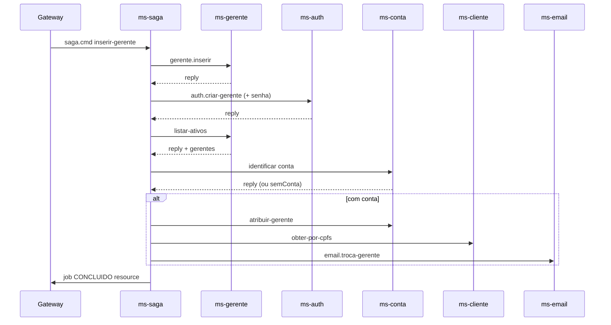

# 13. Fluxo completo: `inserir-gerente` (R13)

[← Voltar ao índice](./README.md) · [Tipos assíncronos](./12-saga-tipos-assincronicidade.md) · [R15](./14-fluxo-remover-gerente.md) · [Rollback](./03-rollback-e-falhas.md)

---

## 13.1 Gatilho HTTP

**Rota:** `POST /gerentes`  
**Arquivo:** [`inserir-gerente.ts`](../backend/gateway/src/routes/inserir-gerente.ts)

1. Valida body com `gerenteInputSchema` (cpf, nome, email, telefone, senha…).
2. `jobId` + job Redis `PENDENTE` com `cpf` do gerente **logado** (dono do job).
3. Publica `saga.cmd`:

```json
{
  "sagaId": "<jobId>",
  "tipo": "inserir-gerente",
  "timestamp": "...",
  "payload": { "cpf", "nome", "email", "telefone", "senha", ... }
}
```

4. **202** + `Location: /jobs/{jobId}/status`.

**Assíncrono:** se `senha` veio no payload, o engine guarda em `SagaSecrets` no `start` e **remove** do `SagaState` persistido ([`SagaEngine.start`](../backend/services/saga/src/main/kotlin/br/ufpr/dac/bantads/saga/engine/SagaEngine.kt#L49-L52)).

---

## 13.2 Receita (7 etapas)

[`SagaRegistry.inserirGerente()`](../backend/services/saga/src/main/kotlin/br/ufpr/dac/bantads/saga/engine/SagaRegistry.kt#L89-L141)

| # | `tipo` | Fila | Kind | Compensação | `skipIfTrue` |
|---|--------|------|------|-------------|--------------|
| 0 | `gerente.inserir` | `ms.gerente.cmd` | TRANSACTIONAL | `gerente.remover` | — |
| 1 | `auth.criar-gerente` | `ms.auth.cmd` | TRANSACTIONAL | `auth.remover` | — |
| 2 | `gerente.listar-ativos` | `ms.gerente.cmd` | TRANSACTIONAL | — | — |
| 3 | `conta.identificar-conta-para-novo-gerente` | `ms.conta.cmd` | TRANSACTIONAL | — | — |
| 4 | `conta.atribuir-gerente` | `ms.conta.cmd` | TRANSACTIONAL | `conta.reatribuir-gerente` | **`semConta`** |
| 5 | `cliente.obter-por-cpfs` | `ms.cliente.cmd` | TRANSACTIONAL | — | **`semConta`** |
| 6 | `email.troca-gerente` | `ms.email.cmd` | FIRE_AND_FORGET | — | **`semConta`** |

### Por que esta ordem?

1. **Cadastro gerente** no domínio gerente antes de credencial.
2. **Auth** com senha (do secrets ou payload inicial).
3. **Listar ativos** — necessário para escolher destino da conta “órfã”.
4. **Identificar** qual conta será transferida ao novo gerente (ou marcar `semConta`).
5. **Atribuir** conta ao novo CPF de gerente.
6. **Buscar e-mails** dos clientes afetados.
7. **Notificar** troca de gerente (melhor esforço).

---

## 13.3 Caminho feliz (com conta para transferir)

Ordem de publicação (teste [`R13 success...`](../backend/services/saga/src/test/kotlin/br/ufpr/dac/bantads/saga/engine/SagaEngineTest.kt#L181-L218)):

1. `gerente.inserir`
2. `auth.criar-gerente` — payload AMQP inclui `senha` via [`extrasFor`](../backend/services/saga/src/main/kotlin/br/ufpr/dac/bantads/saga/engine/SagaEngine.kt#L307-L308)
3. `gerente.listar-ativos`
4. `conta.identificar-conta-para-novo-gerente`
5. `conta.atribuir-gerente` — extra `cpfGerente` = CPF do **novo** gerente no payload
6. `cliente.obter-por-cpfs` — extra `cpfs` montado do payload
7. `email.troca-gerente` — `destinatarios`, `nomeGerente` (sem reply)

**Conclusão:** job `CONCLUIDO`, `resultType: resource`, `dominio: gerentes`, `resourceId: cpf`. `cache.deleteGerente(cpf)`.

---

## 13.4 Variante assíncrona: `semConta: true`

Quando a etapa 3 responde que **não há conta** para realocar:

- Engine avança com `semConta` no payload.
- Etapas 4–6 são **puladas** ([`shouldSkip`](../backend/services/saga/src/main/kotlin/br/ufpr/dac/bantads/saga/engine/SagaEngine.kt#L385-L392)).
- Saga **ainda conclui** com sucesso (teste `R13 semConta skips...`).

**Por quê?** Inserir gerente é válido mesmo sem mover conta; e-mail e realocação são opcionais.

---

## 13.5 Falha e compensação

| Falha típica | Comportamento |
|--------------|---------------|
| E-mail duplicado em `auth.criar-gerente` | Compensa `gerente.remover` (não desfaz etapas que nem rodaram) — teste `R13 duplicate email` |
| Falha em etapa transactional posterior | Compensa na ordem inversa entre etapas com `succeededTipos` |

Não há `email.falha-aprovacao` nesta saga (só R9).

---

## 13.6 Remodelagem do payload (trechos importantes)

| Após reply | Campos úteis para etapas seguintes |
|------------|-----------------------------------|
| `gerente.listar-ativos` | `gerentes[]` |
| `conta.identificar-...` | conta alvo, possível `semConta` |
| `conta.atribuir-gerente` | confirmação, `cpfGerenteOrigem` para compensação |
| `cliente.obter-por-cpfs` | `clientes[]` com email/nome para e-mail |

`email.troca-gerente`: se `destinatarios` vazio, **não publica** ([`publish`](../backend/services/saga/src/main/kotlin/br/ufpr/dac/bantads/saga/engine/SagaEngine.kt#L283-L287)).

---

## 13.7 Diagrama resumido



---

## 13.8 Acompanhamento HTTP

Igual R9: poll `GET /jobs/{jobId}/status` até `CONCLUIDO` / `FALHA`. Resource aponta para o gerente criado.