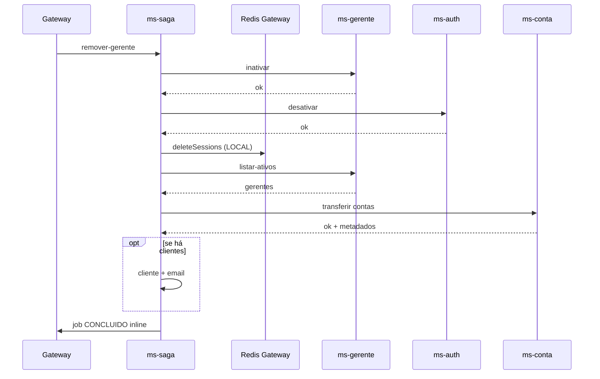

# 14. Fluxo completo: `remover-gerente` (R15)

[← Voltar ao índice](./README.md) · [Tipos assíncronos](./12-saga-tipos-assincronicidade.md) · [R13](./13-fluxo-inserir-gerente.md) · [Auth Redis](./09-gateway-autenticacao-acl.md)

---

## 14.1 Gatilho HTTP

**Rota:** `DELETE /gerentes/:cpf`  
**Arquivo:** [`remover-gerente.ts`](../backend/gateway/src/routes/remover-gerente.ts)

1. **403** se o gerente tentar remover **o próprio** CPF.
2. Job `PENDENTE` + publish:

```json
{
  "sagaId": "<jobId>",
  "tipo": "remover-gerente",
  "payload": { "cpf": "<gerente a remover>" }
}
```

3. **202** + Location do job.

---

## 14.2 Receita (8 etapas — inclui LOCAL)

[`SagaRegistry.removerGerente()`](../backend/services/saga/src/main/kotlin/br/ufpr/dac/bantads/saga/engine/SagaRegistry.kt#L144-L195)

| # | `tipo` | Fila | Kind | Compensação | `skipIfTrue` |
|---|--------|------|------|-------------|--------------|
| 0 | `gerente.inativar` | `ms.gerente.cmd` | TRANSACTIONAL | `gerente.reativar` | — |
| 1 | `auth.desativar` | `ms.auth.cmd` | TRANSACTIONAL | `auth.reativar` | — |
| 2 | **`saga.invalidar-sessao`** | — | **LOCAL** | — | — |
| 3 | `gerente.listar-ativos` | `ms.gerente.cmd` | TRANSACTIONAL | — | — |
| 4 | `conta.transferir-contas-do-gerente` | `ms.conta.cmd` | TRANSACTIONAL | `conta.reverter-transferencia-gerentes` | — |
| 5 | `cliente.obter-por-cpfs` | `ms.cliente.cmd` | TRANSACTIONAL | — | **`semContas`** |
| 6 | `email.troca-gerente` | `ms.email.cmd` | FIRE_AND_FORGET | — | **`semContas`** |

### Por que invalidar sessão no meio?

Após inativar gerente e desativar auth, o gerente **não deve** continuar com JWT válido no Gateway. A etapa LOCAL chama `cache.deleteSessions(cpf)` ([`executeLocal`](../backend/services/saga/src/main/kotlin/br/ufpr/dac/bantads/saga/engine/SagaEngine.kt#L266-L268)).

**Assíncrono híbrido:** a saga segue publicando comandos nos MSs **depois** de um efeito **síncrono** no Redis.

---

## 14.3 Caminho feliz (com contas)

Fluxo de mensagens (teste `R15 transfers accounts...`):

1. `gerente.inativar`
2. `auth.desativar`
3. *(LOCAL)* sessão Redis limpa
4. `gerente.listar-ativos` — escolhe gerente destino (`cpfGerenteDestino`, nome)
5. `conta.transferir-contas-do-gerente`
6. `cliente.obter-por-cpfs`
7. `email.troca-gerente` (fire-and-forget)

**Conclusão:** job `CONCLUIDO`, **`resultType: inline`**, `resultado.mensagem` tipo:

`"Gerente removido; N contas transferidas para <nome destino>"`

[`complete`](../backend/services/saga/src/main/kotlin/br/ufpr/dac/bantads/saga/engine/SagaEngine.kt#L436-L451) usa `quantidadeContas` do payload.

Cliente lê texto: **`GET /jobs/{jobId}/result`**.

---

## 14.4 Variante: `semContas` (zero contas)

- Payload ganha `semContas: true` após transferência (ou equivalente do handler conta).
- Pula obter clientes e e-mail.
- Mensagem: `0 contas transferidas` (teste `R15 success with zero accounts`).
- **Ainda invalida sessão** e cache do gerente.

---

## 14.5 Falha de negócio sem compensar o resto

**Último gerente ativo:** falha em `gerente.inativar` com erro de negócio — **nenhuma** etapa posterior publicada, **sem** invalidar sessão (teste `R15 last active fails`).

| Situação | Publicações | Sessão |
|----------|-------------|--------|
| Falha na 1ª etapa (regra negócio) | só `gerente.inativar` | intacta |
| Falha após sucesso parcial | compensações inversas | depende do ponto de falha |

Compensação de transferência: `conta.reverter-transferencia-gerentes` se etapa 4 tinha sucesso.

---

## 14.6 Diferenças em relação a R9 e R13

| | R9 | R13 | R15 |
|---|----|----|-----|
| Etapa LOCAL | não | não | **invalidar sessão** |
| Job resultado | RESOURCE cliente | RESOURCE gerente | **INLINE** mensagem |
| skip flag | — | `semConta` | `semContas` |
| E-mail | senha cliente | troca gerente | troca gerente |

---

## 14.7 Diagrama



---

## 14.8 Gateway após conclusão

- Poll status até `CONCLUIDO`.
- `GET /jobs/:id/result` para a mensagem inline.
- Gerente removido não consegue mais operar: sessão já foi limpa na etapa 2 se o fluxo passou por lá.