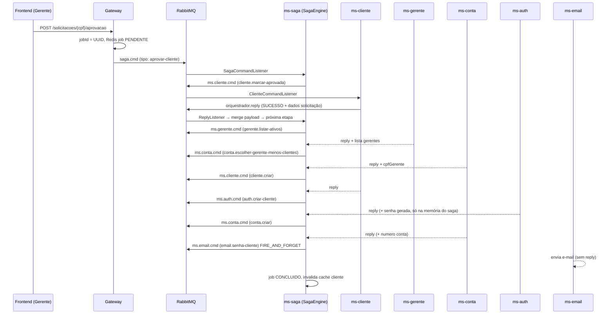

# Tutorial: Saga no BANTADS

Este material explica **como o padrão Saga orquestra operações distribuídas** no projeto DAC/BANTADS: quem publica o quê, em qual fila RabbitMQ, como cada microserviço responde, como o payload vai sendo **acumulado** entre etapas e o que acontece quando algo falha (compensação / rollback).

**Fluxo escolhido como exemplo principal:** `aprovar-cliente` (requisito **R9** nos testes). É o mais completo para apresentação: passa por **Cliente → Gerente → Conta → Cliente → Auth → Conta → Email**, além do **ms-saga** (orquestrador).

---

## Índice

| Documento | Conteúdo |
|-----------|----------|
| [01-visao-geral.md](./01-visao-geral.md) | Papéis, filas, envelopes, tipos de etapa, Redis |
| [02-fluxo-aprovar-cliente.md](./02-fluxo-aprovar-cliente.md) | Passo a passo R9: quem envia, quem recebe, remodelagem do payload |
| [03-rollback-e-falhas.md](./03-rollback-e-falhas.md) | Compensação, DLQ, timeout, casos especiais (e-mail duplicado) |
| **Sagas (todos os fluxos)** | |
| [12-saga-tipos-assincronicidade.md](./12-saga-tipos-assincronicidade.md) | StepKind, skip, LOCAL, jobs RESOURCE/INLINE, comparação R9/R13/R15/echo |
| [13-fluxo-inserir-gerente.md](./13-fluxo-inserir-gerente.md) | R13: inserir gerente, `semConta`, e-mail troca |
| [14-fluxo-remover-gerente.md](./14-fluxo-remover-gerente.md) | R15: inativar, sessão Redis, transferência, `semContas` |
| [15-fluxo-echo.md](./15-fluxo-echo.md) | Saga `echo`: testes de motor, timeout/DLQ |
| [04-apresentacao-professor.md](./04-apresentacao-professor.md) | Roteiro curto para slides / fala oral |
| [05-pastas-ms-saga.md](./05-pastas-ms-saga.md) | Propósito de cada pasta do `ms-saga` + funções e fluxos AMQP/Redis |
| [06-pastas-gateway.md](./06-pastas-gateway.md) | Propósito de cada pasta do Gateway + saga vs proxy |
| [07-fluxos-e-formatos.md](./07-fluxos-e-formatos.md) | Quem entrega/recebe, transformação HTTP → AMQP → job |
| **Gateway (transversal)** | |
| [08-gateway-tipos-de-fluxo.md](./08-gateway-tipos-de-fluxo.md) | Padrões A–I: proxy, composição, saga, job local, reboot |
| [09-gateway-autenticacao-acl.md](./09-gateway-autenticacao-acl.md) | JWT, hook, ACL, login/logout, headers para MS |
| [10-gateway-redis-completo.md](./10-gateway-redis-completo.md) | Jobs, sessão, cache, flush — quem escreve e por quê |
| [11-gateway-catalogo-funcionalidades.md](./11-gateway-catalogo-funcionalidades.md) | Todas as rotas HTTP do Gateway |
| [INDICE-ARQUIVOS.md](./INDICE-ARQUIVOS.md) | Mapa de links para o código-fonte |

---

## Resumo em uma frase

O **Gateway** aceita a requisição HTTP, cria um **job** e publica um comando na fila **`saga.cmd`**. O **ms-saga** (`SagaEngine`) executa uma **coreografia registrada** (`SagaRegistry`), publicando comandos nas filas de cada domínio e esperando **`ReplyEnvelope`** na fila **`orquestrador.reply`**. Se uma etapa falha, o motor dispara **comandos de compensação** na ordem inversa das etapas já concluídas.

---

## Diagrama do caminho feliz (R9)

---

## Outras sagas no mesmo motor

Definidas no mesmo arquivo [`SagaRegistry.kt`](../backend/services/saga/src/main/kotlin/br/ufpr/dac/bantads/saga/engine/SagaRegistry.kt):

| Tipo saga | Origem HTTP (Gateway) | Microserviços envolvidos |
|-----------|----------------------|---------------------------|
| `aprovar-cliente` | [`aprovacao.ts`](../backend/gateway/src/routes/aprovacao.ts) | cliente, gerente, conta, auth, email |
| `inserir-gerente` | [`inserir-gerente.ts`](../backend/gateway/src/routes/inserir-gerente.ts) | gerente, auth, conta, cliente, email |
| `remover-gerente` | [`remover-gerente.ts`](../backend/gateway/src/routes/remover-gerente.ts) | gerente, auth, saga (local), conta, cliente, email |
| `echo` | testes / reboot | saga local + auth |

A mecânica é **idêntica**; muda só a lista de etapas e as compensações.

---

## Onde olhar primeiro no código

1. **Receita da saga R9:** [`SagaRegistry.aprovarCliente()`](../backend/services/saga/src/main/kotlin/br/ufpr/dac/bantads/saga/engine/SagaRegistry.kt) (linhas 34–87)
2. **Cérebro:** [`SagaEngine.kt`](../backend/services/saga/src/main/kotlin/br/ufpr/dac/bantads/saga/engine/SagaEngine.kt) — `start`, `onReply`, `advance`, `compensate`
3. **Entrada HTTP:** [`aprovacao.ts`](../backend/gateway/src/routes/aprovacao.ts)
4. **Teste que documenta ordem das mensagens:** [`SagaEngineTest.kt`](../backend/services/saga/src/test/kotlin/br/ufpr/dac/bantads/saga/engine/SagaEngineTest.kt) — teste `R9 success completes resource job...`

---

*Última atualização: alinhado ao código do repositório DAC/BANTADS.*